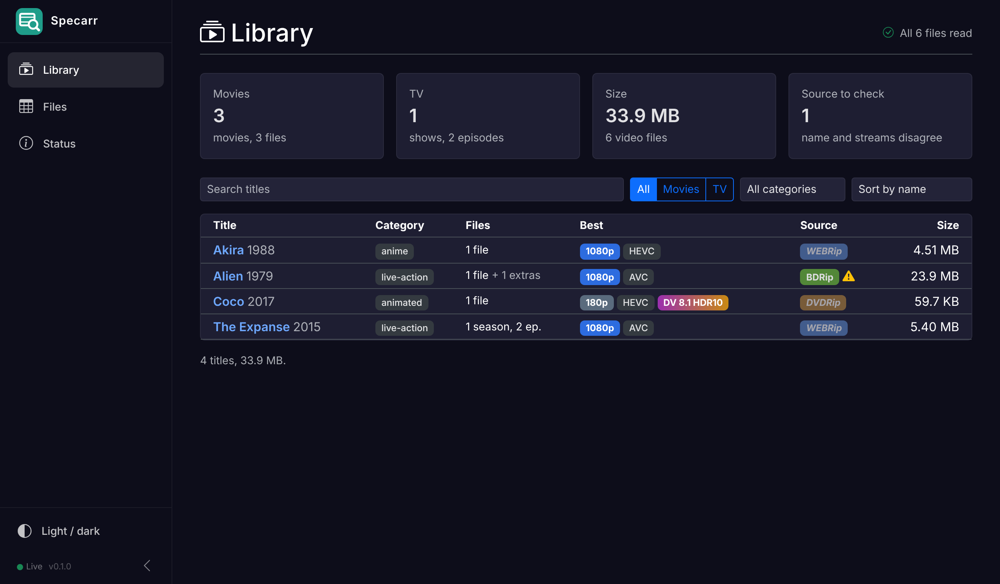
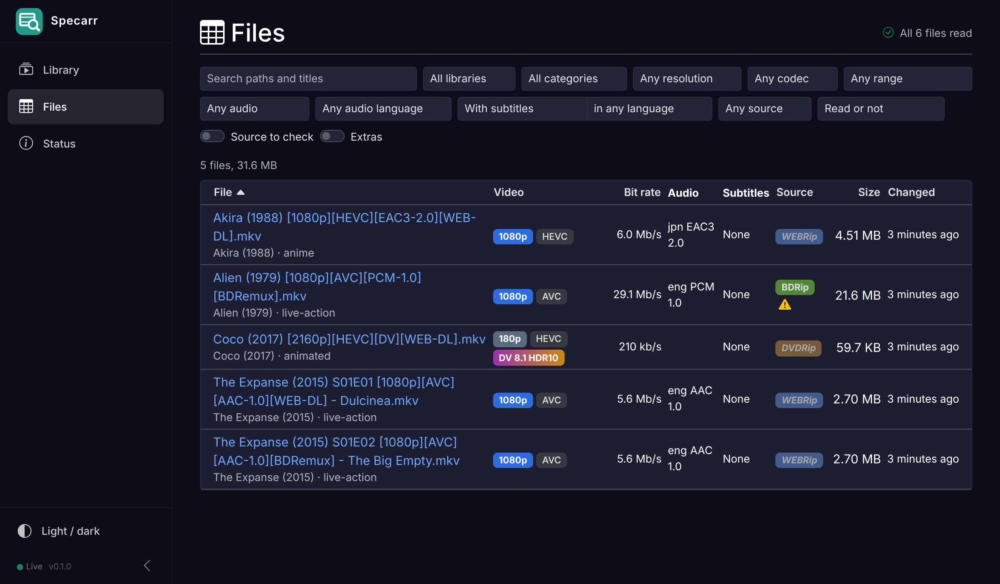
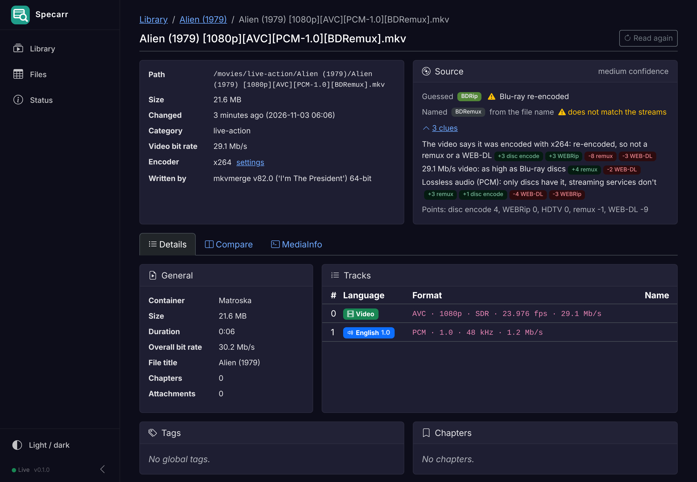

# Specarr

Browse a Radarr/Sonarr media library and see what is inside every file:
tracks, chapters, MKV global tags, Dolby Vision details, and a guess of where
the file comes from (BDRemux, BDRip, WEB-DL, WEBRip, DVD, HDTV) with the clues
behind it.

Specarr is read-only. It is the sister app of
[Salvarr](https://github.com/yannb2/salvarr) and shares its file page.







## What it does

- **Library.** Every movie and show, by library and category
  (`live-action`, `anime`, `animated`, `other`), with the best resolution, HDR or
  Dolby Vision, and the source of its files. Search, filter and sort by name,
  year, newest file or size.
- **Title page.** All files of a movie (several cuts in one folder) or a show,
  season by season, plus its extras (Jellyfin's `Featurettes`, `Trailers`... folders
  and `-trailer` suffixes).
- **Files.** One table of every file, with filters you can combine and bookmark
  (the address bar keeps them): resolution, video codec, SDR / HDR10 / HDR10+ /
  HLG / Dolby Vision profile 5, 7 FEL, 7 MEL or 8, audio codec (or "lossless",
  "Atmos"), audio language, with or without subtitles in a language, guessed
  source, files whose name disagrees with the guess, files not read yet or that
  failed. Sort by name, resolution, video bit rate, source, size or date.
- **File page.** Tracks (codec in Radarr's words, resolution, HDR, Dolby Vision
  profile, Atmos, DTS:X, channels, language, name, flags), chapters, attachments,
  every MKV global tag (what `tag_release.py` writes), the video and audio bit
  rates (see below), the encoder (x264, x265...) and the program that wrote the file (MakeMKV, mkvmerge).
- **Dolby Vision.** dovi_tool reads the RPU of the first 500 frames: profile 7
  FEL or MEL, CM v2.9 or v4.0, L1, L2, L5, L6 and the rest of its summary. "Read
  the whole film" reads every frame.
- **Compare.** The file next to another file of the same title (another cut,
  or the same episode in another quality), with every difference highlighted.
- **MediaInfo.** The raw `mediainfo` output or ffprobe JSON.
- **Status.** Libraries, the background scan (pause, look for new files now,
  retry failures, read everything again), the cache and the tool versions.

## Audio bit rates

Lossy audio (AC3, E-AC3, DTS core, AAC) states its bit rate in every frame.
Lossless audio (TrueHD, DTS-HD MA, FLAC, PCM) only has one when mkvmerge wrote its
statistics tags, which most remuxes have but not all. For the others:

1. mediainfo's average for the track, when it has one.
2. Otherwise Specarr measures it: the size of the audio packets in 6 samples of
   10 s spread over the film (about a minute of reading, once per file). These
   rates show as `≈ 4.2 Mb/s`.
3. With nothing else, the peak from the stream header shows as `up to 9.6 Mb/s`.

Files read by v0.1 are read again in the background to add this; their old
details stay on screen meanwhile.

## The source guess

Each clue adds or removes points for remux, disc encode, WEB-DL, WEBRip and
HDTV; the most points win. A remux of a 480p/576p disc becomes `DVDRemux`, of a
1080p or 2160p disc `BDRemux` (the same for `DVDRip` and `BDRip`). The clues:

| Clue | Points to |
| --- | --- |
| Video bit rate for the resolution (2160p ≥ 45 Mb/s, 1080p ≥ 25 Mb/s...) | remux; low rates point to streams and encodes |
| An x264 / x265 / SVT-AV1 encoder tag in the video | re-encoded: never a remux or a WEB-DL |
| Written by MakeMKV | remux |
| VC-1, or MPEG-2 in SD | disc |
| HEVC at 1080p, AVC at 2160p, AV1 | not a disc (Blu-rays never use them) |
| Lossless audio (TrueHD, DTS-HD MA, DTS:X, PCM), DTS | disc |
| Only EAC3 (Dolby Digital Plus) or AAC audio | streaming |
| PGS or VobSub subtitles | disc; WebVTT points to streaming, DVB to TV |
| Dolby Vision profile 7 (FEL or MEL) | UHD Blu-ray |
| Dolby Vision profile 5 | streaming |
| Interlaced HD, `.ts` files | TV |
| No chapters on a long film | streaming |

The confidence is how far ahead the winner is. Each file also gets the source it
**claims**: the `SOURCE` tag first, then a source word in the file name
(`[BDRemux]`, `WEB-DL`, `BluRay`...). When the claim and a medium or high
confidence guess disagree, the file is flagged "source to check". The file page
lists every clue with its points.

## How it stays fast

- Listing the folders only reads directory entries, so even a big library takes
  seconds. It runs at start, every 6 hours, and on request.
- New and changed files are read in the background, one at a time, newest first.
  Opening a file that is not read yet reads it at once.
- What ffprobe, dovi_tool and mediainfo printed is kept in SQLite
  (`/config/specarr.db`) with each file's size and date. A file is only read again
  when one of them changes, so a restart costs nothing. When Specarr learns to
  show more, the tables are rebuilt from the cache without reading the files.

## Running it

Add the service to the compose file (see [compose.example.yaml](compose.example.yaml)):

```yaml
  specarr:
    image: ghcr.io/yannb2/specarr:dev
    container_name: specarr
    user: 1000:1000
    environment:
      TZ: America/Toronto
    ports:
      - 8185:8185
    volumes:
      - /config/specarr:/config
      - /movies:/movies:ro
      - /tv:/tv:ro
    restart: unless-stopped
```

Create `/config/specarr` owned by the same user first (`mkdir -p /config/specarr`).
Then open `http://<host>:8185`. The image is on the GitHub Container Registry:
`dev` follows `main`, `latest` and version tags come from release tags.

### Dashboard

`GET /api/stats` returns totals for a dashboard such as Homepage's custom API
widget (read-only, no key): `movies`, `shows`, `episodes`, `files`, `sizeBytes`,
`size`, `read`, `pending`, `errors`, `uhd`, `dolbyVision`, `sourceMismatches`
and `loading`.

### Settings

Everything has a default, and any setting can be changed with an environment
variable (`__` separates levels, lists are numbered from 0):

| Setting | Default | Environment variable |
| --- | --- | --- |
| Libraries | Movies at `/movies`, TV at `/tv` | `Specarr__Libraries__0__Path=/movies`, `..._Name`, `..._Kind` (`Movies` or `Series`) |
| Categories as the first folder level | `true` | `Specarr__Libraries__0__Categories=false` |
| Cache file | `/config/specarr.db` | `Specarr__DatabasePath` |
| Look for new files every | `6` hours (`0` = only at start and on request) | `Specarr__RescanHours` |
| Files read at the same time | `1` | `Specarr__ProbeConcurrency` |
| HDR10+ check (decodes 5 frames) | `true` | `Specarr__DetectHdr10Plus` |
| Dolby Vision details (dovi_tool) | `true` | `Specarr__ReadDolbyVision` |
| mediainfo (encoder, writing app) | `true` | `Specarr__ReadMediaInfo` |
| Measure audio bit rates the file does not state | `true` | `Specarr__EstimateAudioBitRate` |
| Skipped folders (dot folders always) | `@eaDir`, `#recycle`, `lost+found`, `$RECYCLE.BIN` | `Specarr__IgnoredFolderNames__0` |
| Extras folders | Jellyfin's names | `Specarr__ExtrasFolderNames__0` |
| Video extensions | `.mkv .mp4 .m4v .avi .ts .m2ts .mov .webm .wmv .mpg .mpeg .iso` | `Specarr__VideoExtensions__0` |

## Building

```sh
dotnet test
dotnet run --project src/Specarr        # http://localhost:8185, cache in ./specarr.db
docker build -t specarr .
```

.NET 10, Blazor Server, Bootstrap 5 (no CDN), SQLite. The image adds ffprobe
(static BtbN build), mediainfo and dovi_tool. CI builds the image on every pull
request, checks that it serves `blazor.web.js` and creates its cache, and pushes
`ghcr.io/yannb2/specarr:dev` from `main`.

## License

GPLv3, like [Muxarr](https://github.com/KirovAir/muxarr), whose look it borrows.
